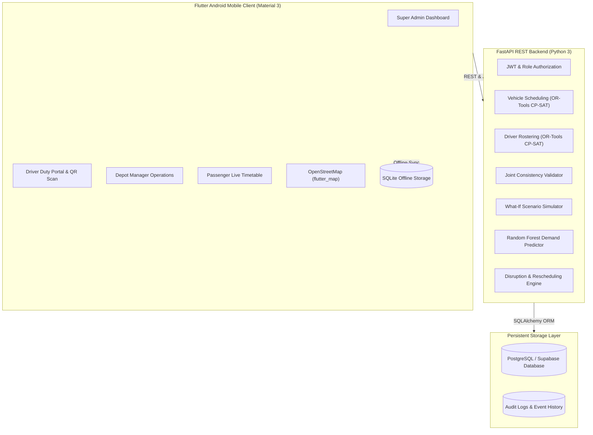

# FleetOpt AI: Autonomous Public Fleet Scheduling and Driver Duty Rostering Combinatorial Optimizer

[](LICENSE)
[](https://python.org)
[](https://fastapi.tiangolo.com)
[](https://developers.google.com/optimization)
[](https://scikit-learn.org)
[](https://flutter.dev)
[](https://postgresql.org)

**FleetOpt AI** is a production-grade, full-stack combinatorial optimizer and fleet operations platform for municipal bus transit systems. It autonomously allocates vehicle blocks, rosters driver duty shifts satisfying union labor constraints, predicts passenger surges using machine learning, and dynamically repairs schedules during real-world breakdowns.

---

## 🚌 System Architecture Overview



---

## 👥 Role-Based Demo Credentials

| Role | Email | Password | Primary Capabilities |
|---|---|---|---|
| **Super Admin / Director** | `admin@fleetopt.ai` | `AdminPass123!` | Full optimization execution, schedule approval, what-if simulator, fleet analytics |
| **Driver** | `driver1@fleetopt.ai` | `DriverPass123!` | Personal duty schedule, QR bus check-in, defect reporting, duty swap requests |
| **Depot Manager** | `depot@fleetopt.ai` | `DepotPass123!` | Depot fleet status, maintenance schedules, vehicle defect logging |
| **Passenger** | `passenger@fleetopt.ai` | `PassPass123!` | Route searches, timetables, live vehicle map, disruption alerts |

*Note: The Flutter client also includes a 1-tap "Quick Evaluation Demo Roles" switcher on the login screen for instant inspection.*

---

## 🧮 Combinatorial Optimization Engine (Google OR-Tools CP-SAT)

The optimizer formulates the Vehicle Scheduling Problem (VSP) and Driver Duty Rostering Problem (DDRP) into exact Constraint Programming (CP-SAT) models:

1. **Vehicle Scheduling Problem (VSP)**:
   - Assigns 30 fleet buses across 10 routes and 100 daily trips.
   - Strictly enforces non-overlapping trips: $\text{end\_time}(i) + \text{deadhead}(i, j) \le \text{start\_time}(j)$.
   - Checks passenger demand capacity: $\text{demand}(i) \le \text{capacity}(v)$.
   - Excludes buses under maintenance or breakdown.
   - Employs explicit penalty variables $u_i$ for uncovered trips (never invents ghost buses).

2. **Driver Duty Rostering Problem (DDRP)**:
   - Allocates 40 qualified drivers to vehicle blocks.
   - Enforces configurable maximum duty duration ($\le 8.0$ hours) and mandatory minimum rest ($\ge 11.0$ hours).
   - Enforces required rest breaks (45 min after 4.5h driving).
   - Respects driver qualifications (standard bus, articulated bus, electric minibus).
   - Strictly blocks assignments during approved leave.
   - Optimizes soft objectives: overtime minimization, workload balancing, and shift preference satisfaction.

3. **What-If Scenario Simulator**:
   - Clones operational scenario in-memory.
   - Perturbs fleet count, driver absenteeism, demand surge %, and vehicle breakdowns.
   - Solves against baseline and returns comparative impact deltas without modifying production schedules.

---

## 🧠 AI Passenger Demand Prediction

- **Model**: Scikit-Learn Random Forest Regressor (`n_estimators=50`).
- **Features**: Time window hour, day of week, route hash embedding, holiday indicator, event indicator, weather condition.
- **Evaluation**: Trained on 700 historical ridership records with an 80/20 held-out test set ($R^2 \approx 0.89$, MAE $\approx 2.8$ passengers).
- **Fallback**: Rolling historical average baseline when sample size $< 10$.

---

## 📁 Monorepo Directory Layout

```
c:\bus fleet\
├── backend/                  # FastAPI REST API & OR-Tools CP-SAT Optimizer
│   ├── app/
│   │   ├── core/            # App configuration & settings
│   │   ├── database/        # SQLAlchemy session & engine
│   │   ├── models/          # 30 Normalized database entity models
│   │   ├── schemas/         # Pydantic request/response schemas
│   │   ├── security/        # JWT, password hashing & RBAC
│   │   ├── optimization/    # VehicleScheduler, DriverRosterer, JointOptimizer, Simulator
│   │   ├── ml/              # Random Forest DemandPredictor
│   │   ├── routers/         # REST API routers (auth, fleet, transit, optimize, operations, analytics)
│   │   └── main.py          # FastAPI application entrypoint
│   ├── tests/               # Backend unit and integration test suite
│   ├── Dockerfile           # Railway production container spec
│   └── requirements.txt     # Python dependencies
│
├── mobile/                   # Flutter Android Application (Material 3)
│   ├── lib/
│   │   ├── config/          # Theme (Navy palette) and constants
│   │   ├── models/          # Dart entity data classes
│   │   ├── services/        # Dio API client & SQLite offline cache
│   │   ├── providers/       # Riverpod state management providers
│   │   ├── router/          # GoRouter with role guards
│   │   ├── screens/         # Admin, Driver, Depot, Passenger, Map & Simulator screens
│   │   └── widgets/         # KpiCard, StatusBadge, AppDrawer
│   ├── android/             # Android Gradle project (Application ID: com.fleetopt.ai)
│   ├── test/                # Flutter widget tests
│   └── pubspec.yaml         # Flutter dependencies
│
├── database/
│   ├── migrations/          # 001_initial_schema.sql (PostgreSQL/Supabase DDL with RLS)
│   └── seeds/               # seed_demo_data.py (30 buses, 40 drivers, 10 routes, 100 trips)
│
├── scripts/                 # PowerShell runner and setup scripts
├── docs/                    # Architecture, Supabase setup, and Railway deployment guides
└── README.md
```

---

## 🚀 Quickstart Instructions

### 1. Backend Setup & Run

```powershell
# Navigate to backend and activate virtualenv
cd backend
.\venv\Scripts\Activate.ps1

# Seed the database with demo fleet data (30 buses, 40 drivers, 100 trips)
python ..\database\seeds\seed_demo_data.py

# Run FastAPI server
uvicorn app.main:app --host 0.0.0.0 --port 8000 --reload
```

- API Health Check: `http://localhost:8000/api/health`
- Interactive OpenAPI Docs: `http://localhost:8000/docs`

### 2. Run Automated Test Suites

```powershell
# Run backend pytest suite (all 8 tests pass)
pytest backend/tests/test_backend.py -v

# Run Flutter mobile tests
cd mobile
flutter test
```

### 3. Run Mobile App

```powershell
cd mobile
flutter run -d chrome
# Or target Android device / emulator:
flutter run -d android
```

---

## 📦 Android APK Release Build

The Android project is configured with:
- **Application ID**: `com.fleetopt.ai`
- **Application Name**: `FleetOpt AI`
- **Permissions**: Internet, Network State, Camera (QR scanning), Location (GPS tracking)
- **Minimum SDK**: 21 (Android 5.0+)
- **Compile SDK**: Android 34

To build the release APK:
```powershell
cd mobile
flutter pub get
flutter analyze --no-fatal-infos
flutter test
flutter build apk --release
```
Output path: `mobile/build/app/outputs/flutter-apk/app-release.apk`
